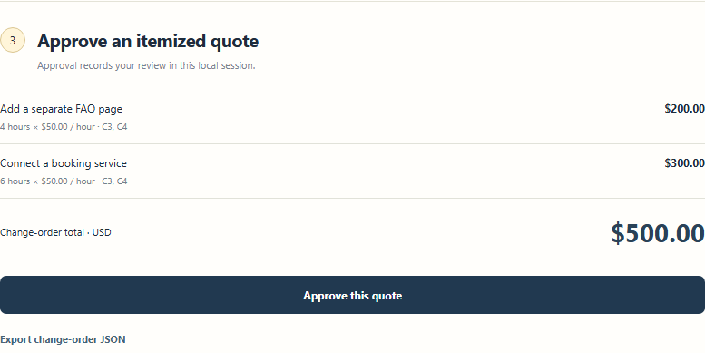

# ScopeGuard

A freelancer change-order assistant for the **PayPal AI Hackathon**. Compare incoming requests with an agreed scope, inspect exact clause evidence, review itemized pricing, and create a PayPal sandbox draft invoice. Prices come from user estimates and an hourly rate, never from model output.

Public source: [Vcode2407/paypal-scopeguard](https://github.com/Vcode2407/paypal-scopeguard) · [judge walkthrough](docs/JUDGES.md) · [submission draft](docs/SUBMISSION.md).

[Watch the silent local walkthrough (2:17)](docs/videos/local-walkthrough.mp4). It shows the actual local review flow; [recording disclosure and written walkthrough](docs/LOCAL_DEMO.md) explain the remaining live AI/PayPal steps.

## Run locally

Node 22 or newer. The pinned `jose` dependency validates OpenAI identity tokens; all other runtime components use Node's built-in APIs.

```powershell
npm ci
npm start
npm test
npm run check
npm run demo:verify
```

Open http://127.0.0.1:4185. Compare the built-in requests: an additional FAQ page and booking integration are extra-work suggestions, while a headline-colour edit is included subject to revision limits. Review the actual clauses, select the extra work, preview the $500 total at $50/hour, and approve the quote. Export the JSON evidence.

Default mode uses bounded local rules and **no AI model or PayPal connection**. Assessments and approvals are temporary and disappear on restart. The fixed agreement is fictional; this prototype assists review and does not determine contractual rights.

The [judge walkthrough](docs/JUDGES.md) reproduces the account-free flow and lists the remaining live integration steps. `npm run demo:verify` starts an isolated local server with provider traffic explicitly blocked, verifies the $500 quote and approval, and writes clearly labelled evidence to ignored `artifacts/local-demo-evidence.json`. [GitHub CI](.github/workflows/ci.yml) is configured for Node 22 on Windows and Ubuntu; all provider tests use synthetic responses.



The screenshot shows the actual local preview. It is not live AI or PayPal invoice evidence.

After the account owner has completed official ChatGPT consent and selected an account-returned model, `npm run evidence:chatgpt -- --confirm-plan-use` requests exactly one assessment of the fixed fictional sample and saves sanitized requested/returned model provenance to ignored `artifacts/chatgpt-live-evidence.json`. This explicit command consumes plan allowance. It refuses incomplete setup and never signs in, chooses another provider, retries inference or calls PayPal. [One-shot evidence details](docs/CHATGPT_PLAN.md#capture-one-fictional-live-assessment).

## Configure real AI and PayPal sandbox

Copy `.env.example` to ignored `.env`. Restart after editing.

- **Use your ChatGPT Pro plan:** choose **My ChatGPT plan** as the assessment source and prepare sign-in. Open **Continue with ChatGPT**, review the requested permission to use your plan, and complete sign-in yourself. Return to ScopeGuard, refresh the connection, load the models returned by your actual account, and select one. Comparing the requests then sends this fictional scope and the entered request text to OpenAI using your eligible plan allowance. Choose an existing saved sign-in when reconnecting; issued registrations remain available for recovery after a failed attempt. Cancel a pending sign-in from the same panel. No API key is required for the official local/open-source sign-in flow. Credentials stay in protected backend storage; the browser never receives tokens. If private storage cannot be established, this option is unavailable and the local workflow still starts. See [setup, security boundaries and current validation](docs/CHATGPT_PLAN.md). Actual owner consent, connection and model discovery were verified on October 11, 2026; no completed live assessment has been accepted.
- **Alternatively use Nebius:** configure `NEBIUS_API_KEY` and an explicit `NEBIUS_MODEL` available in your account, then select Nebius as the assessment source. The backend calls Token Factory chat completions, validates the resulting request classifications, and grounds citations in the supplied scope. Requested and provider-returned model identities are kept separate. A failure is reported; it does not silently turn a rule-based result into an AI result. Provider requests incur the selected account's charges. No live inference has been verified.
- **Local rules remain the default**, even when another provider is configured. Changing the source clears the old assessment and quote, and an AI source without access fails rather than silently running local rules. Model output cannot set prices, approve quotes, create invoices, or choose tools.
- PayPal: use [Developer Dashboard sandbox credentials](https://developer.paypal.com/api/get-started/), `PAYPAL_SANDBOX_CLIENT_ID` and `PAYPAL_SANDBOX_SECRET`. A sandbox business account with Invoicing enabled and a sandbox buyer are needed. Credentials remain on the backend. The endpoint is fixed to `https://api-m.sandbox.paypal.com`; there is no live mode.
- After approving a quote, enter the **sandbox buyer account email** and click **Create PayPal sandbox draft**. The adapter authenticates with OAuth, creates an invoice with a retained request ID, reads its actual status, and verifies the returned total. It never sends invoices or records fabricated payments. A known invoice ID survives a failed status lookup; an unknown creation outcome blocks another automatic POST. A request ID alone is not assumed to guarantee Invoicing API deduplication. Check the sandbox dashboard before creating a new quote after an uncertain result.
- To demonstrate payment lifecycle, send/pay the invoice manually through your sandbox accounts and refresh its actual status in ScopeGuard. This application's current integration supports draft creation and status reconciliation; sending and checkout are outside its implemented scope.

The optional Nebius path permits one assessment at a time and defaults to **ten dispatched attempts per server process**. Failed requests, timeouts and refused responses consume that allowance; missing configuration, an exhausted budget or a concurrent-request refusal does not dispatch another call. Each request has a 25-second deadline and a 1,800-token output limit, refuses redirects, and reads at most **150,000 provider-response bytes** before cancelling an oversized stream. The same response byte limit protects PayPal responses. Nebius output is accepted only when `finish_reason` is exactly `stop` and the assessment passes JSON and supplied-clause validation; filtered, tool-call, truncated and missing completion states are refused. Restarting resets the local attempt allowance. These limits are not a guaranteed billing or spending cap.

ChatGPT model discovery has a separate **1 MiB (1,048,576-byte)** streamed catalog limit and a maximum of 500 entries. It returns only valid, visible model IDs and display names, preserving their order. Oversized responses are cancelled; rejected catalogs preserve the previous verified catalog. Loading or selecting a model does not dispatch inference. The separate ChatGPT inference stream remains limited to 96,000 bytes and a 20-second deadline. [Connection and request limits](docs/CHATGPT_PLAN.md).

An unexpected inference response is cancelled without reading its body. The error reports only a bounded HTTP status and one fixed content-type category: `application/json`, `text/event-stream`, `other` or `missing`. Raw bodies, header parameters and status text are excluded. A completed, validated SSE assessment remains required; these diagnostics neither accept another response format nor retry inference.

`GET /api/config` exposes an optional `nebiusStatus` object containing only `configured`, `attemptedCalls`, `callLimit`, `callsRemaining` and `inFlight`. It contains no key, authorization header or provider configuration dump. The field is `null` for a custom provider without this status interface. Configuration and attempt counters do not establish successful live inference; an accepted assessment records its actual AI source and model provenance separately.

References: [PayPal Invoicing quickstart](https://developer.paypal.com/api/invoicing/), [Invoices v2 reference](https://developer.paypal.com/api/invoicing/v2), [REST request/idempotency guidance](https://developer.paypal.com/api/make-api-requests), [Token Factory quickstart](https://docs.tokenfactory.nebius.com/quickstart), [Sign in with ChatGPT](https://developers.openai.com/siwc/quickstart).

## Validation and submission gates

All **63 tests pass locally**. Meaningful tests cover clause grounding, actual HTTP workflow, deterministic totals, review fingerprints, non-billable requests, invalid estimates, provider failures, Nebius attempt/concurrency limits, response-stream cancellation, completed-response requirements, safe status exports, authoritative sandbox status, stable retries and origin/expiry checks. Model-catalog regressions cover detailed responses above the prior size limit, whitelist/order preservation, the 1 MiB streamed cap and the 500-entry bound without inference. Diagnostics tests verify unexpected-body cancellation without reads, status/category whitelisting and malicious-header redaction. All provider responses in automated tests are stubs.

On **October 11, 2026**, the owner completed ChatGPT consent and the app verified a connected, plan-sharing account. The authenticated catalog displayed three models and `gpt-6-luna` was selected. Exactly one authorized fictional assessment was attempted; it failed with `STREAM_INVALID`, leaving **one attempt and zero accepted assessments**. The first attempt's HTTP status, content type and underlying cause were not captured. [Sanitized connection/failure proof](docs/evidence/chatgpt-connection-check-2026-10-11.json). No assessment export or PayPal action resulted from that check. Meaningful live AI output and an actual PayPal sandbox invoice remain unverified. A further diagnostic attempt needs a separate explicit owner decision and can consume plan allowance.

Deadline: **November 13, 2026, 01:30 IST**. [Official rules](https://paypalaihackathon.devpost.com/rules).

- [ ] Validate meaningful AI on actual requests and record the chosen model.
- [ ] Create an actual sandbox invoice, manually exercise the sandbox payment lifecycle, and verify the returned status/amount.
- [x] [Public MIT-licensed repository](https://github.com/Vcode2407/paypal-scopeguard) with runnable setup, source and assets.
- [ ] Working judge-accessible demo or complete local setup instructions.
- [ ] Public YouTube demonstration under three minutes and English project description.
- [ ] Complete Devpost fields and maintain judge access through the required period.

Recording outline: introduce scope creep (20s), classify the client request and inspect clauses (40s), review deterministic pricing (35s), create the real sandbox invoice and reconcile its sandbox payment status (45s), explain AI/PayPal boundaries and next steps (20s). Record only the flows that have actually been verified.
